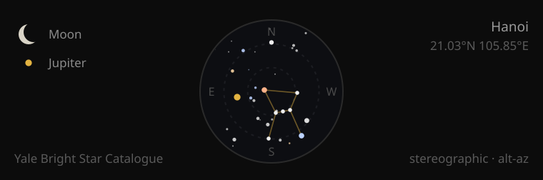
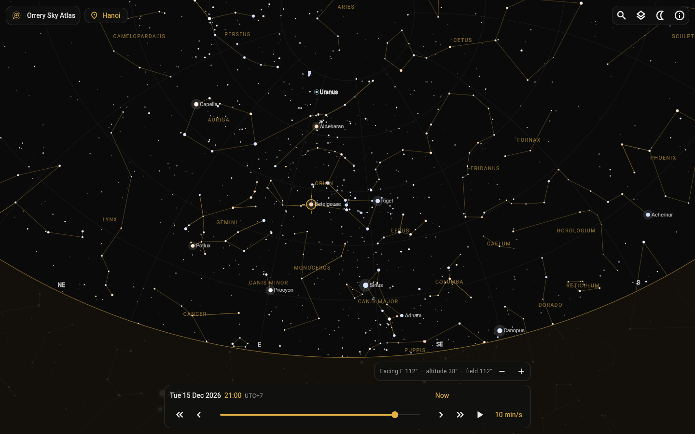
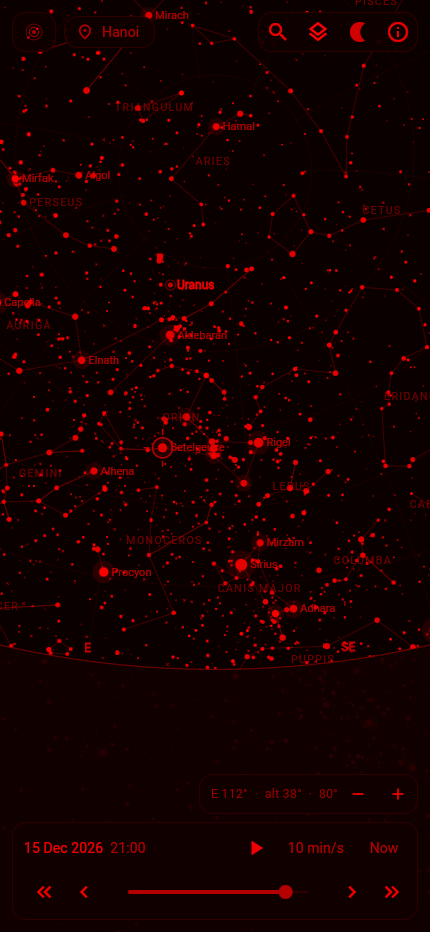

<p align="center"></p>

# Orrery Sky Atlas

A planetarium for Android, iOS and the web, written in Flutter on top of a
small pure-Dart astronomy library that reproduces the worked examples in
Meeus's *Astronomical Algorithms*.

[](https://github.com/TIENDUNG21/orrery-sky-atlas/actions/workflows/ci.yml)
[](LICENSE)

<p align="center"></p>



Live: <https://tiendung21.github.io/orrery-sky-atlas/>. The screenshot above
is the release web build rendered by headless Edge, and can be reopened at
[this link](https://tiendung21.github.io/orrery-sky-atlas/?loc=hanoi&t=2026-12-15T21:00:00%2B07:00&az=112&alt=38&fov=112&select=hr:2061).

It draws the 9096 stars of the Yale Bright Star Catalogue, the 88
constellation figures, the Sun, the Moon with its phase and the seven planets
for any place on Earth and any moment between 1800 and 2050, as seen from
that place: above or below the horizon, lifted by refraction, with the sky
brightening through twilight.

## Usage



Drag to look around, pinch or scroll to zoom, tap a star or planet to see its
designation, magnitude, spectral type, coordinates and today's rise, transit
and set times in local time. The bar at the bottom moves the clock by hours
or days, scrubs through the night, picks a date or plays time forward at up
to 24 hours per second. The place button offers 14 presets (seven Vietnamese
cities, observatories, both hemispheres) or any coordinates typed as
`21.0285 N`, `21,03`, or `105°51′15″ E`.

Search accepts proper names (`Vega`), Bayer designations in any spelling
(`α Ori`, `alp ori`, `alpha Orionis`), Flamsteed numbers (`61 Cyg`), HR
numbers (`HR 7001`), constellations and planets. The layers menu hides
figures, names, the grid or the ground; night mode turns the whole interface
red to keep the eye dark-adapted.

On the web the URL can carry a view: `t` (ISO 8601 instant), `loc` (preset
such as `hanoi`, `sydney`, `paranal`) or `lat`, `lon`, `tz`, then `az`,
`alt`, `fov`, `night=1` and `select=hr:2061`. Values that do not parse are
ignored.

<br clear="right">

## How it works

Each frame computes where every object stands relative to the observer's
horizon at one instant. The pipeline lives in `packages/astro` and
`lib/src/sky/`:

1. Time scales. The instant becomes a Julian day in UT (for Earth's
   rotation) and in TT (for the motion of the Sun, Moon and planets), related
   by ΔT from the Espenak and Meeus polynomials.
2. Sidereal time. Greenwich mean sidereal time (Meeus 12.4) plus the
   equation of the equinoxes gives apparent sidereal time; adding the
   observer's longitude gives local sidereal time.
3. Precession. Catalogue positions are J2000. A rotation through the
   angles ζ, z and θ (Meeus 21) carries them to the mean equator of date,
   after proper motion is applied as a small displacement on the sphere.
4. Horizontal coordinates. Rotating by the local sidereal time and then
   by the latitude turns equatorial vectors into east-north-up vectors. Both
   rotations are composed into one 3×3 matrix per frame, so each star costs
   one matrix product.
5. Refraction and parallax. Altitudes are lifted by Sæmundsson's formula
   (Meeus 16.4); the Moon is also lowered by its diurnal parallax, up to 1°.
6. Projection. A stereographic projection centred on the view direction
   maps vectors to the screen. It is conformal, so constellations keep their
   shape at the edge of a wide view, and the horizon stays an exact circle,
   which is how the ground is filled.

The Sun follows Meeus chapter 25, the Moon chapter 47 with the full tables
47.A and 47.B, and the planets JPL's approximate Keplerian elements (Standish)
with light-time, nutation and aberration; ADR 0004 explains that trade.

The catalogue is built offline. `tool/build_catalog.dart` parses the BSC5
fixed-width records, joins the constellation figures and a list of 163
common names, and writes a 286 KB binary asset that stores positions at
catalogue precision as integers and ends with a CRC-32. A damaged file fails
with a message that names the problem instead of producing an empty sky. See
[docs/ARCHITECTURE.md](docs/ARCHITECTURE.md) and the
[decision records](docs/adr/).

## Accuracy

Differences from the worked examples in Meeus, computed by
`packages/astro/tool/accuracy_report.dart` with the book's inputs. The full
table of 24 comparisons is in [docs/ACCURACY.md](docs/ACCURACY.md); each
example is also a unit test with a stated tolerance.

| Example | Quantity | Meeus | Difference |
|---|---|---|---|
| 12.a | mean sidereal time, 1987 Apr 10 0h UT | 13h10m46.3668s | below 0.0001 s |
| 13.b | altitude of Venus from Washington | 15.1249° | 0.09″ |
| 21.b | θ Persei precessed to 2028 | 41.547214°, 49.348483° | 0.01″, 0.00″ |
| 25.a | apparent right ascension of the Sun | 198.38083° | 0.02″ |
| 47.a | apparent right ascension of the Moon | 134.688470° | 0.12″ |
| 47.a | Earth–Moon distance | 368409.7 km | 0.02 km |
| 48.a | illuminated fraction of the Moon | 0.6786 | below 0.0001 |
| 49.a | new Moon of 1977 February | JDE 2443192.65118 | 32 s |
| 33.a | apparent position of Venus | 316.17273°, −18.88801° | 6.2″, 2.0″ |
| 15.a | rising, transit, setting of Venus at Boston | 12h25m, 19h41m, 2h55m | under 1 s |

The Venus and new-Moon rows are the ones where this library deliberately uses
a smaller theory than the book (JPL elements instead of VSOP87, root-finding
on its own Sun and Moon instead of the phase series). Stars are drawn without
nutation and annual aberration, together at most about 40″, far below a pixel
at any zoom level the app allows.

## Performance

`tool/bench_scene.dart`, median of repeated runs on the Dart VM (JIT), Intel
i7-14700K, 32 GB RAM, Windows 11:

| Step | Time |
|---|---|
| decode the 286,143-byte catalogue | 1.65 ms |
| compute a scene (9096 stars, Sun, Moon, 7 planets) | 0.43 ms |
| lay out a 1440×900 frame (1211 stars, 283 segments, 40 labels) | 0.21 ms |

The browser runs the same code compiled to JavaScript, so these numbers
compare changes rather than predict frame rates on the web. The release web
build loads `main.dart.js` (2.8 MB) and CanvasKit (5.5 MB for Chromium
browsers, 7.3 MB otherwise), both uncompressed sizes.

## What was verified

- 224 automated tests pass: 120 in `packages/astro` and 104 in the app,
  including widget tests at 360, 430 and 800 pixels wide that fail on any
  layout overflow.
- CI on `ubuntu-latest` builds the web app, checks it for the
  `/orrery-sky-atlas/` sub-path and deploys it to GitHub Pages, and builds a
  release APK that is uploaded as a workflow artifact.
- The screenshots come from the release web build served under the same
  sub-path and rendered by headless Edge on Windows.

Not verified: the app has not been run on a physical Android or iOS device
or an emulator, the APK is signed with Flutter's debug key, and no iOS build
was made (CI has no macOS runner).

## Limitations

- Planet positions use elements valid from 1800 to 2050, and time travel is
  clamped to that range.
- Locations use fixed offsets from UTC. Daylight saving time is not modelled,
  so in Sydney or Greenwich during summer time the displayed local time is an
  hour off.
- ΔT after 2005 is the Espenak and Meeus extrapolation, about 6 s larger than
  the measured value (69 s in 2025); this moves the Moon by about 3″.
- Refraction assumes 10 °C and 1010 hPa. Rise and set times use the standard
  altitudes of Meeus chapter 15 and are reported for the local calendar day,
  so a Moon that rises twice in one day shows the first event only.
- Only the Bright Star Catalogue: no deep-sky objects, no stars fainter than
  about magnitude 8, no constellation boundaries.
- Proper names cover 163 stars, in English.

## Building from source

Flutter 3.50 (Dart 3.14). The committed asset means a fresh clone runs
without network access.

```sh
flutter pub get
flutter run -d chrome                       # or an Android or iOS device
flutter test                                # app tests
(cd packages/astro && dart pub get && dart test)
flutter build web --release --base-href /orrery-sky-atlas/ --no-web-resources-cdn
dart run tool/verify_web_build.dart build/web /orrery-sky-atlas/
flutter build apk --release
```

To rebuild the catalogue from the original sources:

```sh
dart run tool/fetch_data.dart               # downloads to .cache/, checks SHA-256
dart run tool/build_catalog.dart            # writes assets/catalog/sky.bin
```

## Project layout

```
packages/astro/lib/src/time      Julian dates, ΔT, sidereal time
packages/astro/lib/src/coords    transforms, precession, nutation, refraction, parallax
packages/astro/lib/src/bodies    Sun, Moon, phases, Kepler, planets, magnitudes, rise/set
packages/astro/lib/src/catalog   BSC5 parser, names, constellation lines, binary codec
lib/src/sky                      scene, projection, frame layout, painter, hit testing
lib/src/state, lib/src/ui        controller, canvas, time bar, sheets, night mode
tool/                            fetch, build and verify scripts, benchmark
data/                            constellation names and star names (authored)
```

## Roadmap

Not done in 1.0.0: running and profiling on real Android and iOS devices; an
iOS build in CI; time zones with daylight saving rules; the device's own
location; writing a sky link from the current view; Messier objects and
constellation boundaries; persisting settings between sessions; the full
IAU 1980 nutation series and VSOP87 for planets where arcsecond accuracy
matters.

## Data and credits

- Yale Bright Star Catalogue, 5th Revised Ed. (Hoffleit D., Warren Jr W.H.,
  Astronomical Data Center, NSSDC/ADC, 1991; CDS catalogue V/50), from the
  copy distributed by the Harvard-Smithsonian Center for Astrophysics.
- Constellation figures: [ConstellationLines](https://github.com/MarcvdSluys/ConstellationLines)
  by Marc van der Sluys, licensed
  [CC BY 4.0](https://creativecommons.org/licenses/by/4.0/). The BSC numbers
  were converted to the binary figure table; no lines were changed. Details in
  [assets/catalog/NOTICE.md](assets/catalog/NOTICE.md).
- Star names follow the spellings of the IAU Working Group on Star Names;
  the list in `data/star_names.txt` and the constellation table were compiled
  for this project.

## References

- Jean Meeus, *Astronomical Algorithms*, 2nd ed., Willmann-Bell, 1998.
- E. M. Standish, *Keplerian Elements for Approximate Positions of the Major
  Planets*, JPL Solar System Dynamics.
- F. Espenak and J. Meeus, *Five Millennium Canon of Solar Eclipses:
  −1999 to +3000*, NASA/TP-2006-214141, 2006 (ΔT polynomials).
- D. Hoffleit and W. H. Warren Jr, *The Bright Star Catalogue*, 5th Revised
  Ed. (Preliminary Version), 1991.
- F. J. Ballesteros, "New insights into black bodies", *Europhysics Letters*
  97, 34008, 2012 (B−V to temperature).

## License

Code: MIT, see [LICENSE](LICENSE). The data in `assets/catalog/sky.bin` keeps
the terms of its sources listed above.
