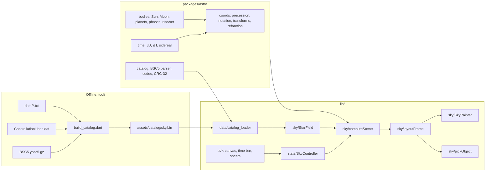

# Architecture

Orrery Sky Atlas is two Dart packages. `packages/astro` knows astronomy and
the catalog format and has no Flutter dependency. The Flutter app in `lib/`
turns its results into a picture and handles input. Inside the app, all code
up to "where does each object land on the screen" is plain Dart as well, so
the only code that needs a rendering surface is the painter and the widgets.

## From an instant to a pixel

A frame is produced in three stages, each cached for as long as its inputs
stay the same.

**Scene** (`lib/src/sky/sky_scene.dart`), recomputed when the instant or the
place changes. `AstroTime` carries the instant as Julian days in UT and in TT
(`ΔT` from the Espenak and Meeus polynomials). Greenwich apparent sidereal
time (Meeus 12.4 plus the equation of the equinoxes) and the observer's
longitude give local sidereal time. Two 3×3 rotations are composed once per
scene: precession from J2000 to the date (Meeus 21, angles ζ, z, θ) and the
equator-of-date to east-north-up rotation (local sidereal time, then the
latitude tilt). Every star is then one vector update for proper motion, one
matrix product and one refraction lift (Sæmundsson's formula, Meeus 16.4).
`StarField` prepares the J2000 unit vectors and their drift per year once per
catalog, so the loop over 9096 stars has no trigonometry except the
refraction. The Sun (Meeus 25), the Moon (Meeus 47, with topocentric parallax)
and the planets (ADR 0004) are computed as apparent places of date and rotated
with the second matrix only.

**Frame** (`lib/src/sky/sky_frame.dart`), recomputed when the view changes.
The stereographic projection (ADR 0003) maps vectors to screen points. The
limiting magnitude depends on the field of view and on the Sun's altitude, so
stars fade out in twilight and appear as you zoom in. Constellation segments
are kept when both ends project and the segment is not absurdly long. Labels
are placed greedily in priority order (planets and the Moon, compass points,
first-magnitude stars, constellation names, other named stars) and a label is
dropped if its box overlaps one already placed; a test checks that no two
labels overlap.

**Paint** (`lib/src/sky/sky_painter.dart`). Background colour from the Sun's
altitude, the altitude-azimuth grid, figures, stars (size from magnitude,
colour from B−V through the Ballesteros temperature formula and a black-body
fit), the Sun, the Moon with its lit polygon rotated to the bright-limb
position angle (Meeus 48.5), planets, then the ground, so that objects below
the horizon are dimmed rather than hidden, and labels last.

## State and input

`SkyController` (`lib/src/state/sky_controller.dart`) is the single
`ChangeNotifier` holding the instant, place, view, layers and selection. It
clamps time to 1800–2050 (the range of the planetary elements), the field of
view to 5–200° and altitude to ±90°. The UI never computes astronomy; it calls
controller methods (`shiftTime`, `pan`, `zoomBy`, `focusOn`) and rebuilds.

`SkyCanvas` turns drags into `pan` using the projection's pixels per degree,
pinches and mouse wheel into `zoomBy`, arrow keys and +/− into both, and taps
into `pickObject`, which scores candidates by distance with a penalty for
stars and faint objects so that a planet beside a faint star wins. Night mode
is a `ColorFiltered` with a luminance-to-red matrix placed above the
`Navigator`, so sheets and dialogs turn red as well.

On the web, `main.dart` reads `Uri.base`; `SkyLink` accepts `t`, `loc`,
`lat`, `lon`, `tz`, `az`, `alt`, `fov`, `night` and `select` and ignores any
value it cannot parse. The README screenshots were taken through such links.

## Catalog pipeline

`tool/fetch_data.dart` downloads the Bright Star Catalogue from the Harvard
CfA copy and the constellation lines from a pinned commit, and checks SHA-256
digests. `tool/build_catalog.dart` parses each BSC5 record
(`parseBsc5Line`, which reports the HR number and field on malformed input),
resolves `data/star_names.txt` designations to HR numbers (failing on unknown
or ambiguous designations, such as double-star components that share a
Bayer letter), joins the 88 constellations and their figures, encodes the
result (ADR 0002) and decodes it again before writing. `test/catalog_asset_test.dart`
checks the committed asset.

## Testing

- `packages/astro/test/`: the Meeus worked examples with stated tolerances,
  property tests (Kepler's equation, transform round trips, matrix against
  trigonometric paths), codec corruption cases, BSC5 parser edge cases.
- `test/sky/`: projection round trips, horizon circle, label overlap, scene
  consistency with the step-by-step reduction.
- `test/data/`, `test/search/`, `test/details/`: coordinate input, sky links,
  search normalisation (Greek letters, accents, NFD input, emoji), rise and
  set times.
- `test/ui/`: widget tests for time travel, gestures, the location form,
  search, details, layers, night mode, and layout without overflow at 360,
  430 and 800 logical pixels.

CI (`.github/workflows/ci.yml`) runs format, both analyzers, both test suites,
a web build with `tool/verify_web_build.dart`, and a release APK build whose
file is uploaded as an artifact. `pages.yml` builds the web app for the
`/orrery-sky-atlas/` sub-path and deploys it to GitHub Pages.
